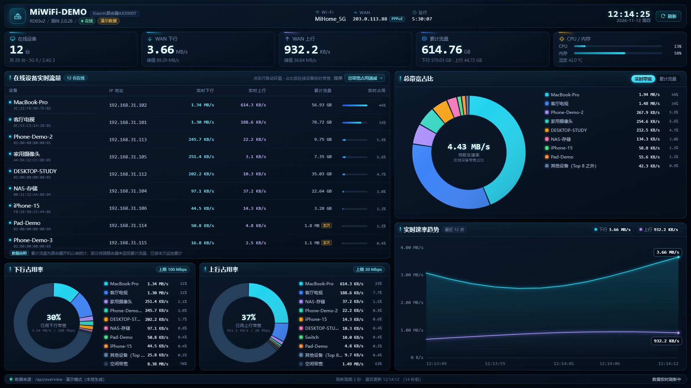

# 谁偷走了我们的 50Mbps

一个基于 **Python Flask + 小米路由器本地管理接口** 的网络实时监控大屏。浏览器打开即可查看当前连接设备、每台设备的实时上下行速率、累计流量，以及设备之间的带宽占用率。

> 已在小米路由器 AX3000T（MiWiFi 2.0.28）上实测通过。程序只读取路由器本地接口，不上传任何数据到云端。
>
> 截图使用内置的演示数据，设备名、IP、MAC 均为虚构；真实运行数据不会离开本机。



## 用途及使用 AI 编程的声明

本项目使用 DeepSeek V4.1 Flash 实现。项目使用目的是宿舍只有 50Mbps 宽带，总有舍友偷偷全速下载导致网络质量不佳 ~~（还不承认）~~ ，米家 APP 暂时只能最多绑定一个用户实时查看路由器流量信息，登录内网后台对于一些人来说又“太过困难”，而使流量使用数据透明公开则 ~~在宿舍辩论赛中~~ 非常重要，于是用 AI 撰写了这个项目。测试路由器：AX3000T；固件版本2.0.28

## 功能

- **在线设备总览**：设备名、IP、MAC、实时下行 / 上行、累计流量；支持按名称升序、上行流量递减、下行流量递减、总带宽占用递减排序。
- **实时网速**：读取路由器实时速率字段，默认每 2 秒刷新。
- **累计流量**：WAN 口开机以来总流量；每台设备优先使用路由器累计计数。
- **带宽占用率环形图**：
  - 「总带宽占比」：每台设备实时带宽占所有在线设备带宽之和的比例，可在实时带宽 / 累计流量之间切换；
  - 「下行占用率」「上行占用率」：每台设备速率相对配置的最大上下行带宽的占比，未占满部分显示为「空闲带宽」。
- **实时趋势图**：最近约 3 分钟的 WAN 上下行速率曲线。
- **异常兜底**：路由器短暂离线时保留上一帧数据并显示「数据已过期」，恢复后自动继续，不会白屏。
- **演示模式**：没有路由器或不想配置密码时，可用模拟数据预览完整大屏。

## 快速开始（conda）

```powershell
# 1. 克隆或下载本仓库后进入目录
cd miwifi-dashboard

# 2. 创建并激活 conda 环境
conda env create -f environment.yml
conda activate miwifi-dashboard

# 3. 生成本地配置，填写路由器管理密码
Copy-Item .env.example .env
notepad .env

# 4. 启动
python app.py
```

浏览器打开 <http://127.0.0.1:5000/>。

如果已有可用的 Python 环境，也可以：

```powershell
pip install -r requirements.txt
python app.py
```

### 一键启动（Windows）

双击 `start.bat`，或在 PowerShell 中执行：

```powershell
powershell -ExecutionPolicy Bypass -File .\run.ps1
```

脚本会自动寻找项目内 `.conda-env` / `.venv`、用户 conda 环境 `miwifi-dashboard` 或 PATH 中的 Python，并使用已安装的 Flask 启动。

## 配置项

配置从项目根目录 `.env` 读取，环境变量优先级更高。可从 `.env.example` 复制。

| 变量 | 默认值 | 说明 |
| --- | --- | --- |
| `MIWIFI_HOST` | `192.168.31.1` | 路由器管理地址，可带 `http://` |
| `MIWIFI_USERNAME` | `admin` | 管理账号，小米路由器通常固定为 admin |
| `MIWIFI_PASSWORD` | 空 | **路由器管理密码，必填**（不是 Wi-Fi 密码） |
| `MIWIFI_POLL_INTERVAL` | `2` | 采样间隔（秒），不建议低于 1 秒 |
| `MIWIFI_TIMEOUT` | `6` | 单次请求超时（秒） |
| `MIWIFI_DEMO` | `0` | 设为 `1` 使用演示数据，不连接路由器 |
| `MIWIFI_MAX_DOWNLINK_MBPS` | `100` | 宽带套餐标称最大下行带宽（Mbps），用于下行占用率饼图；`0` 表示未配置 |
| `MIWIFI_MAX_UPLINK_MBPS` | `20` | 宽带套餐标称最大上行带宽（Mbps），用于上行占用率饼图；`0` 表示未配置 |
| `MIWIFI_BIND` | `127.0.0.1` | 监听地址；需要局域网其他设备访问时设为 `0.0.0.0` |
| `MIWIFI_PORT` | `5000` | 监听端口 |
| `LOG_LEVEL` | `INFO` | 日志级别 |

> `MIWIFI_PASSWORD` 只保存在本机 `.env`，不会发送到浏览器、不会写入日志。`.env` 已被 `.gitignore` 排除。
>
> `MIWIFI_MAX_DOWNLINK_MBPS` / `MIWIFI_MAX_UPLINK_MBPS` 请按宽带套餐实际标称值填写；默认值仅为示例，配置错误会导致占用率饼图比例不准确。

## 数据来源与口径

后端以约 2 秒为周期调用路由器本地接口：

| 接口 | 用途 |
| --- | --- |
| `GET /cgi-bin/luci/web` | 获取登录用 `key` / `deviceId` / 加密模式 |
| `POST /cgi-bin/luci/api/xqsystem/login` | nonce 哈希登录，获得 `stok` |
| `/api/misystem/status` | WAN 速率与累计流量、CPU/内存、设备累计流量 Top N |
| `/api/misystem/devicelist` | 当前在线设备、名称、IP、实时速率 |
| `/api/misystem/newstatus` | SSID、2.4G/5G 在线数、型号 |
| `/api/xqsystem/router_name` | 路由器名称 |
| `/api/xqnetwork/pppoe_status` | WAN IP、网关、拨号方式 |

口径说明：

- 速率单位均为 **B/s**，页面会格式化为 KB/s、MB/s；流量单位均为 **字节**。
- WAN 累计流量为路由器**开机以来**的累计值，路由器重启后归零。
- 每台设备的累计流量优先采用路由器返回的计数；部分固件只返回流量 Top N 设备，未返回的设备会显示「本次」角标，表示本次服务启动后的本地累计。
- WAN 速率与所有在线设备速率之和可能存在少量差异（采样时刻不同）。
- 路由器 `status.dev` 中无 MAC 的 “Others” 行是**未进入 Top N 的在线设备**的流量汇总；设备列表已包含这些设备，为避免重复计数，总带宽占比饼图不叠加 Others。
- 「总带宽占比」分母为在线设备实时速率之和；「下行 / 上行占用率」分母为配置的最大带宽，两者口径不同，界面已分别标注。

## HTTP 接口

- `GET /api/overview`：大屏主数据，详见 [`docs/api-contract.md`](docs/api-contract.md)。
- `POST /api/refresh`：立即触发一次采样。
- `GET /api/health`：采集健康状态。
- `GET /`：大屏页面。

## 测试

```powershell
# 单元测试（演示模式，不依赖路由器）
python -m unittest discover -s tests -v

# 真实路由器连通性测试（只读，不修改路由器）
$env:MIWIFI_LIVE_TEST="1"
python -m unittest tests.test_dashboard.LiveRouterTests -v
```

## 安全说明

- 程序只调用路由器**读取类**接口，不会修改 Wi-Fi、密码、限速或任何路由器设置。
- 路由器管理密码仅用于后端登录，不会出现在 API 响应或前端页面；Wi-Fi 密码、PPPoE 账号等字段在整形阶段被丢弃。
- 默认只监听 `127.0.0.1`。改为 `0.0.0.0` 让电视/平板访问时，请确认局域网可信，不要把端口直接暴露到公网。
- 本项目未实现登录鉴权，不建议部署在公网服务器上。

## 常见问题

**页面显示「路由器登录失败」**
- 检查 `.env` 中的 `MIWIFI_PASSWORD` 是否是路由器**管理密码**（不是 Wi-Fi 密码）。
- 连续输错密码可能触发路由器临时锁定，等待几分钟再试。
- 确认浏览器能打开 `http://192.168.31.1`。

**设备累计流量显示「本次」**
- 该设备不在路由器返回的流量 Top N 列表中，页面展示本次服务启动后的累计值。

**占用率饼图显示「未配置最大带宽」**
- 在 `.env` 中设置 `MIWIFI_MAX_DOWNLINK_MBPS` / `MIWIFI_MAX_UPLINK_MBPS`，然后重启服务。

**从其他设备打不开**
- 将 `.env` 中 `MIWIFI_BIND` 改为 `0.0.0.0`，使用本机局域网 IP 访问，并放行 Windows 防火墙对应端口。

## 项目结构

```
/
├── app.py                 # Flask 入口与 API 路由
├── config.py              # 环境变量 / .env 配置
├── miwifi/
│   ├── client.py          # 小米路由器登录、token、只读接口客户端
│   ├── service.py         # 后台采样、数据合并、历史缓存
│   └── demo.py            # 演示数据源
├── templates/index.html   # 大屏页面
├── static/
│   ├── css/dashboard.css
│   └── js/
│       ├── charts.js      # 原生 Canvas 环形图 / 趋势图
│       └── dashboard.js   # 轮询、渲染、交互、排序
├── docs/
│   ├── api-contract.md    # 前后端数据契约
│   └── sample_overview.json
├── tests/test_dashboard.py
├── requirements.txt
├── environment.yml
├── .env.example
├── run.ps1 / start.bat
└── screenshots/
```

## 技术栈

- Python 3.11+ / Flask 3 / requests
- 原生 HTML / CSS / JavaScript，无 CDN、无前端构建步骤；环形图与趋势图均为原生 Canvas 绘制，可离线运行
